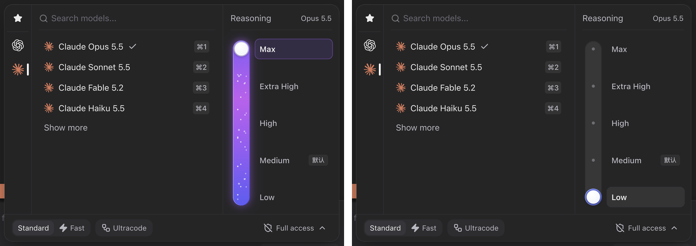
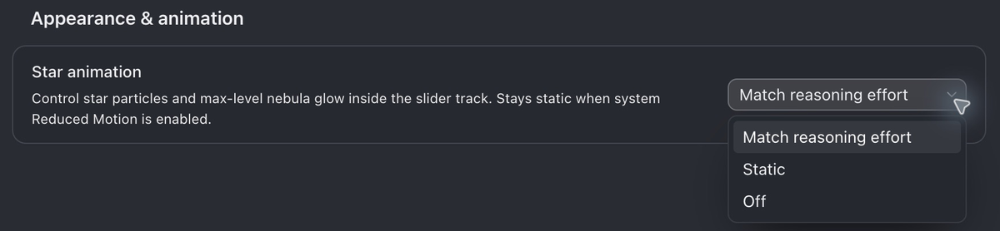

[简体中文](README.md) | **English**

# Effort slider

Replaces the reasoning effort list in the composer with a stepped slider; higher levels make the stars brighter and faster, and the top level adds a flowing nebula.




An extension for [T3 Code Extensions](https://github.com/ZiHao256/t3code-extensions), an unofficial extension host for [T3 Code](https://github.com/pingdotgg/t3code). Install it in Settings → Extensions → Browse, or paste `https://github.com/ZiHao256/t3x-effort-slider` into the URL field there. "Check for updates" offers this repository's latest release, installed after you confirm.

## Features

- A vertical stepped slider: the highest level is at the top, with level names next to the ticks. Click a level to pick it, or drag the thumb and it snaps to the nearest level when you let go.
- Keyboard: the up and down arrow keys change the level; past the top or bottom level they go back to moving focus in the panel. Screen readers announce the current level.
- The stars get brighter and faster at higher levels, and the top level adds a flowing nebula.
- Pick the star animation in Settings → Extensions → Effort slider → Settings: match reasoning effort, static or off. With the system's "reduce motion" setting on, the stars are always static.
- Animations only change position and opacity and run on the compositor in sync at 20 fps, so they stay off the main thread and light on the GPU.



## Install with an agent

Paste this to Claude Code, Codex or another coding agent:

```text
Install the T3 Code extension "Effort slider" (https://github.com/ZiHao256/t3x-effort-slider) on this Mac.
1. Check that T3 Code Extensions is installed. If it isn't, install it first by following the "Install with an agent" section of https://github.com/ZiHao256/t3code-extensions/blob/main/README.en.md, and ask me before quitting T3 Code.
2. Open ~/Applications/T3 Code Extensions.app, go to Settings → Extensions → Browse, and install "t3x-effort-slider" from the community list, or paste https://github.com/ZiHao256/t3x-effort-slider into the link field and click Add. In the confirmation dialog, check that the source is ZiHao256/t3x-effort-slider before confirming.
3. In the Installed tab, make sure it is enabled and tell me its version.
If you can't operate the app's UI, do step 1, then tell me exactly what to click for steps 2 and 3.
```

## Requirements

`apiVersion` 2: needs a T3 Code Extensions host that supports it. Older hosts refuse to install this version.

## Development

- `npm test` runs the tests (Node 22+, no dependencies).
- To try changes: Settings → Extensions → Add local extension, pick this folder, then click refresh on its card after each edit.

## Release

1. Change the code, bump `version` in `plugin.json`, run `npm test`, and commit.
2. Tag that commit `v<version>`, push it with the tag, and publish a GitHub release ("Check for updates" reads the latest release).

## Community

This project takes part in and recognizes the [LINUX DO community](https://linux.do).

## License

MIT
