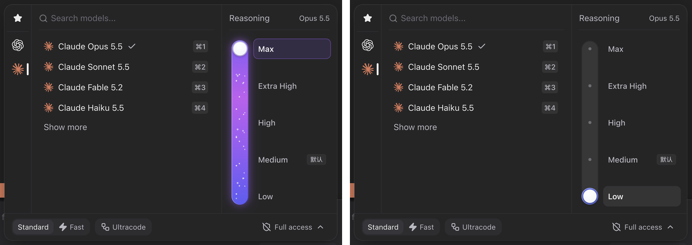

**简体中文** | [English](README.en.md)

# 推理强度滑条

把输入框推理强度面板里的档位列表换成分档滑条，档位越高星点越亮越快，最高档流动星云。




[T3 Code Extensions](https://github.com/ZiHao256/t3code-extensions) 的扩展，T3 Code Extensions 是 [T3 Code](https://github.com/pingdotgg/t3code) 的非官方扩展宿主。在 设置 → 扩展 →「浏览」里安装，或者把 `https://github.com/ZiHao256/t3x-effort-slider` 粘贴到那里的链接框。「检查更新」取本仓库的最新 Release，确认后安装。

## 让 agent 安装

把下面的提示词发给 Claude Code、Codex 等 coding agent：

```text
帮我在这台 Mac 上给 T3 Code 装「推理强度滑条」扩展（https://github.com/ZiHao256/t3x-effort-slider）。
1. 确认已安装 T3 Code Extensions。没装的话，先按 https://github.com/ZiHao256/t3code-extensions 里「让 agent 安装」一节装好；要退出 T3 Code 前先问我。
2. 打开 ~/Applications/T3 Code Extensions.app，进入 设置 → 扩展 →「浏览」，在社区扩展里安装 t3x-effort-slider；或者把 https://github.com/ZiHao256/t3x-effort-slider 粘贴到链接框里点「添加」。确认框里核对来源是 ZiHao256/t3x-effort-slider 再确认。
3. 在「已安装」里确认它已启用，告诉我版本号。
如果你没法操作应用界面，做完第 1 步后，把第 2、3 步具体点哪里告诉我。
```

## 依赖

只依赖宿主提供的 `host` 接口（`apiVersion` 2），旧版宿主会拒绝安装。

## 开发

- `npm test` 运行测试（Node 22+，不依赖 npm 包）。
- 试改动：设置 → 扩展 →「添加本地扩展」选本仓库目录，改完点卡片上的刷新。

## 发版

1. 改代码和 `plugin.json` 的 `version`，跑 `npm test`，提交。
2. 在这个提交上打 `v<version>` 标签，连标签一起推送并发布 GitHub Release（「检查更新」看的是最新 Release）。

## 许可

MIT
